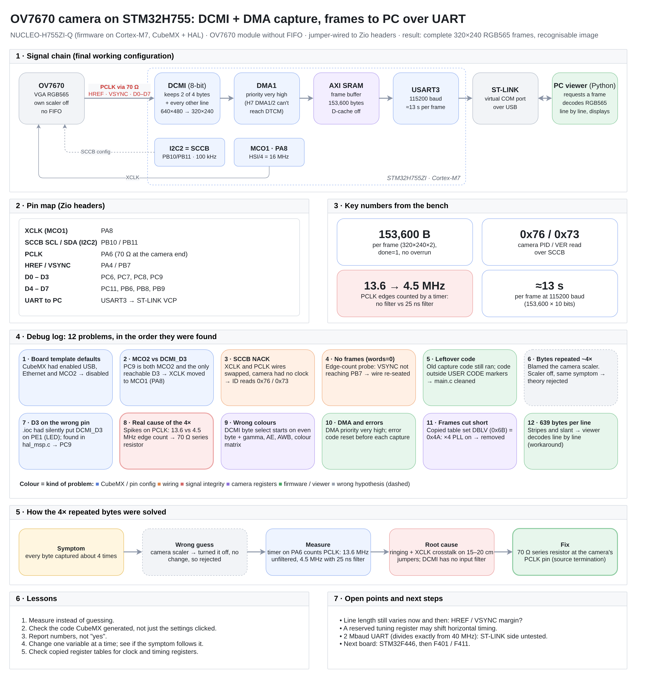
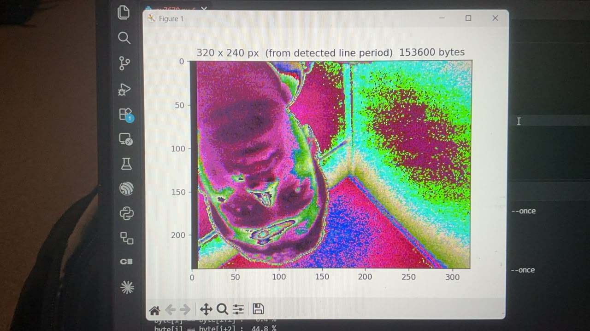
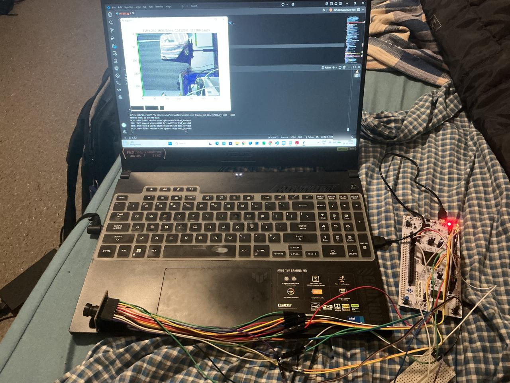
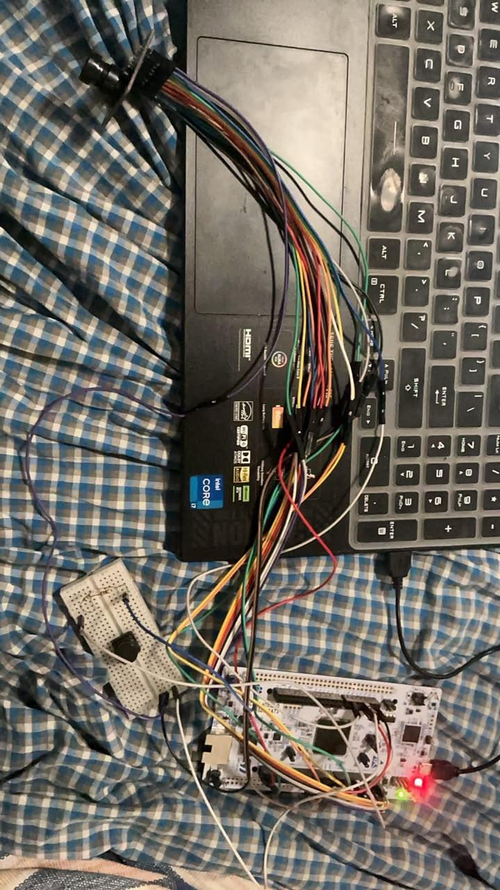

# OV7670 Camera Capture on STM32H755 (DCMI + DMA, frames to PC over UART)

Capture still images from an OV7670 camera module (no FIFO) with the STM32H755's DCMI peripheral and DMA, then send them over UART to a Python viewer on a PC.

**Status:** working on NUCLEO-H755ZI-Q. Complete 320×240 RGB565 frames and a recognisable image. Some line-length errors remain (see [Limitations](#limitations)).



Editable source of the infographic: [images/ov7670-infographic.drawio](images/ov7670-infographic.drawio) (open in [draw.io](https://app.diagrams.net)).

## Results

| Earlier capture: right geometry, wrong colours | Live capture after colour tuning |
|---|---|
|  |  |
| 320×240, **153,600 bytes** (photo of the screen) | Viewer shows 319×240, **638 bytes/line, 153,120 bytes**, 115200 baud. Firmware log: `INFO done=1 words=38280 bytes=153120 dcmi_err=0x0` on 4 captures in a row |

The early image is rotated because of how the camera was held; the viewer has `--rot` for this.
The recent captures are consistently **480 bytes short** of a full frame (2 bytes missing per line) and have a stripe in the first columns, even though the DCMI reports no error (`dcmi_err=0x0`).

## Hardware setup



NUCLEO-H755ZI-Q, OV7670 module on ~15–20 cm jumper wires, small breadboard for the PCLK series resistor. The live-capture photo under [Results](#results) shows the same setup running.

| Item | Detail |
|------|--------|
| Board | NUCLEO-H755ZI-Q (STM32H755ZIT6, Cortex-M7 + M4). Firmware runs on the **M7**; the M4 project is the untouched CubeMX default. |
| Camera | OV7670 without FIFO |
| Tools | STM32CubeIDE / CubeMX, HAL |
| PC | Python 3: `pyserial`, `numpy`, `pillow`, `matplotlib` |

### Pin map (checked against `stm32h7xx_hal_msp.c`)
| Signal | STM32 pin |
|---|---|
| XCLK (MCO1 = HSI/4 = 16 MHz) | PA8 |
| SCCB SCL / SDA (I2C2, 100 kHz) | PB10 / PB11 |
| PCLK | PA6 (70 Ω series resistor at the camera end) |
| HREF / VSYNC | PA4 / PB7 |
| D0–D7 | PC6, PC7, PC8, PC9, PC11, PB6, PB8, PB9 |
| UART | USART3 (PD8/PD9) → ST-LINK virtual COM port |

## How it works

```
OV7670 ──PCLK/HREF/VSYNC/D0–D7──► DCMI ──► DMA1 Stream0 ──► AXI SRAM buffer ──► USART3 ──► ST-LINK VCP ──► viewer/ov7670.py
   ▲  ▲
   │  └── XCLK 16 MHz (MCO1, PA8)
   └───── SCCB register writes + read-back (I2C2)
```

Firmware: [`firmware/ov7670_h7_nucleo/CM7/Core/Src/main.c`](firmware/ov7670_h7_nucleo/CM7/Core/Src/main.c)

1. **Camera setup** (`camera_config`): reset, then VGA RGB565 with the camera's own scaler off and `CLKRC = 0x01` (internal clock = XCLK/2). Every register is read back over SCCB and mismatches are printed.
2. **Colour tuning** (`camera_tune`): gamma, AGC/AEC, white balance and colour matrix values from the Linux `ov7670` driver (GPL-2.0). Clock and window registers are left out on purpose, including DBLV `0x6B`, whose copied value switched on the ×4 PLL.
3. **Downscaling in the DCMI:** byte select keeps 2 of every 4 bytes, starting on the even byte, and line select keeps every other line. 640×480 becomes 320×240 × 2 bytes = 153,600 bytes.
4. **Capture** (`capture_and_send`): snapshot mode into an oversized 160 KB buffer in AXI SRAM. DMA1 cannot reach DTCM, and the D-cache is off. The real size is computed from the DMA counter, so short frames show up as numbers instead of being hidden.
5. **Protocol:** the PC sends `c`; the MCU answers `INFO done=.. words=.. bytes=.. dcmi_err=..`, then `FRAME <n>` and `n` raw bytes.
6. **Built-in diagnostics:** `measure_pclk` borrows PA6 for TIM3 and counts PCLK edges for 1 ms with no filter, a ~25 ns filter and a ~50 ns filter. `sig_probe` counts level changes on PCLK, HREF and VSYNC to prove each wire is connected.

### Viewer
[`viewer/ov7670.py`](viewer/ov7670.py)
```
python viewer/ov7670.py COM5 --once          # one frame: analyse, plot, save frame.bin + frame.png
python viewer/ov7670.py COM5                 # live view
python viewer/ov7670.py --file frame.bin     # analyse a saved frame, no board needed
```
The viewer decodes line by line (bytes per line = total / 240), so an odd line length does not turn the image into stripes. It also prints byte-repeat statistics and the line period it finds in the data.

## Debugging log

| # | Symptom | Root cause | Fix |
|---|---|---|---|
| 1 | Unexpected peripherals active | CubeMX board template enabled USB, Ethernet, MCO2 | Disabled them |
| 2 | PC9 conflict | PC9 = MCO2 and the only DCMI_D3 reachable on the Zio headers | XCLK moved to MCO1 (PA8) |
| 3 | SCCB NACK | XCLK and PCLK wires swapped: camera had no clock | Rewired; ID reads PID=0x76, VER=0x73 |
| 4 | No frames (`words=0`) | VSYNC not reaching PB7 (found with `sig_probe`) | Re-seated the wire |
| 5 | Unexplained behaviour | Old capture code still running; code outside `USER CODE` markers | Cleaned up `main.c` |
| 6 | Every byte captured ~4× | First blamed the camera scaler. Turning it off changed nothing, so that theory was **wrong** | — |
| 7 | One data bit wrong | CubeMX had silently put DCMI_D3 on PE1 (LED pin) because PC9 was still locked as MCO2 in the `.ioc`. Found by reading `stm32h7xx_hal_msp.c` | D3 back on PC9 |
| 8 | Bytes still repeated | **Extra edges on PCLK:** `measure_pclk` counted 13.6 MHz unfiltered vs 4.5 MHz with the 25 ns filter. Ringing and crosstalk on the long jumpers | **70 Ω series resistor at the camera's PCLK pin** |
| 9 | Wrong colours | Byte selection started on the wrong byte; no colour tuning | Start on the even byte; added the tuning table |
| 10 | Overruns, stale errors | DMA priority Low (CubeMX default); error code kept from the last capture | DMA priority very high; error code reset per capture |
| 11 | Frames suddenly cut short | Copied tuning table set DBLV (0x6B) = 0x4A, the camera's ×4 PLL | Removed that write |
| 12 | Stripes and slant | 639 (later 638) bytes per line instead of 640 | Viewer decodes line by line. **This is a workaround, not a fix.** |

### Why a series resistor fixes the false clock edges
The camera drives PCLK with fast edges. On a 15–20 cm jumper wire the edge reflects off the high-impedance DCMI input and rings, and the 16 MHz XCLK wire next to it adds crosstalk. The DCMI has no input glitch filter, so every threshold crossing is counted as a clock edge. A resistor at the **source** end, together with the driver's output impedance, roughly matches the wire's impedance, so the reflection is absorbed when it gets back to the camera. It also slows the edge a little, which reduces crosstalk. 47–100 Ω is the usual range: too small and the ringing stays; too large and the edge becomes too slow for the data timing.

## Limitations
- **Line length is not always 640 bytes.** Recent captures give 638 B/line (153,120 B) every time with `dcmi_err=0x0`, so no overrun is reported; the bytes are probably missing before the DCMI rather than dropped by the DMA (not proven). Possible causes: HREF timing/window registers or HREF signal integrity. The viewer hides this; the source is not fixed.
- **PCLK numbers don't add up yet.** With `CLKRC = 0x01` and a 16 MHz XCLK, PCLK should be about 8 MHz. The filtered count was 4.5 MHz and the unfiltered count 13.6 MHz. Not explained yet.
- **Slow transfer:** 153,600 B × 10 bits / 115200 baud ≈ 13 s per frame. This is a still-image setup.
- **Jumper-wire build:** the resistor value suits this wiring and may not carry over to another board.
- **Leftover pin config:** `MX_GPIO_Init` still configures PA11/PA12 for USB OTG, left over from the board template.
- **Licence:** the tuning values come from the GPL-2.0 Linux `ov7670` driver (credited in the source).


## Lessons
1. Measure instead of guessing.
2. Check the code CubeMX actually generated, not just the settings you clicked.
3. Report numbers, not "yes".
4. Change one variable at a time and see if the symptom follows it.
5. Check any copied register table for registers that touch clocks or timing.

## Repository layout
```
firmware/ov7670_h7_nucleo/   STM32CubeIDE dual-core project (.ioc, CM7 = camera code, CM4 = default, HAL drivers)
viewer/ov7670.py             PC viewer and raw-data analyser
images/                      infographic (.png + .drawio), setup photo, live capture, early capture
```
Build output (`Debug/`) is not committed. Open the project in STM32CubeIDE and build the CM7 target.

## References
- ST RM0399: STM32H745/755 and STM32H747/757 reference manual (DCMI, DMA, timers).
- OmniVision OV7670 datasheet.
- Linux kernel `drivers/media/i2c/ov7670.c` (source of the tuning values).
